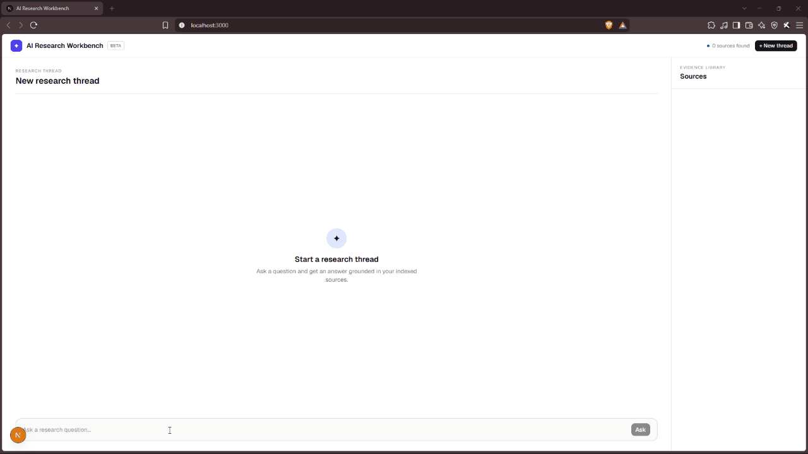

# AI Research Workbench

A full-stack research assistant that answers questions grounded in live web search — streaming Claude's response token-by-token while showing the real sources it used.



## What it does

- **Ask a question** → the backend searches the web via Tavily, injects the results into Claude's prompt as numbered context, and streams the grounded answer back in real time
- **See the evidence** → every answer updates a sources panel with real titles, excerpts, and links — the exact documents the model was given, not model-invented citations
- **Follow up naturally** → "what are its limitations?" works: a query-rewrite step resolves references against conversation history before searching
- **Recover gracefully** → loading, error, and retry states; interrupted streams show partial output with a retry banner

## Architecture

```
┌─────────────────┐   POST /chat/stream     ┌─────────────────────────────────┐
│   Next.js 16    │   (UIMessage history)    │           FastAPI               │
│  React 19 + TS  │ ───────────────────────▶ │                                 │
│  useChat stream │ ◀─── text/plain tokens ─ │  1. Rewrite follow-ups into     │
│                 │                          │     standalone queries          │
│  SourcesPanel   │   GET /sources           │  2. Tavily web search           │
│  (updates via   │ ───────────────────────▶ │  3. Inject sources as numbered  │
│   DOM event)    │                          │     context in system prompt    │
└─────────────────┘                          │  4. Stream Claude via Bedrock   │
                                             └───────────┬─────────────────────┘
                                                         │
                                        ┌────────────────┴────────────────┐
                                        ▼                                 ▼
                                 AWS Bedrock (boto3)              Tavily Search API
                                 Claude Sonnet 4.6                (httpx)
```

**Why the pieces are shaped this way:**

- **Search is backend-owned.** The browser never sees API keys, and sources are fetched server-side so the panel shows exactly what the model received.
- **Pre-search injection, not a tool loop.** Rather than give Claude a search *tool* (multi-turn, complex, and unsupported by Bedrock anyway), the backend searches first and injects results — simpler and the sources arrive "for free."
- **Query rewriting for follow-ups.** Tavily only sees the search query, so pronouns and references ("its limitations") are resolved into standalone queries by a cheap non-streaming model call. The answering model still gets the original conversation.
- **Two event loops bridged honestly.** boto3 is synchronous, so blocking calls run via `asyncio.to_thread` and the stream is iterated in a worker thread that feeds an `asyncio.Queue` — `/health` responds during an active stream.
- **Sibling state via DOM event.** `page.tsx` is server-rendered but sources must update when the client-side stream completes — `Conversation` dispatches `answer-complete` and `useSources` refetches. Small, honest, no global state library.

## Tech stack

| Layer | Choices |
|---|---|
| Frontend | Next.js 16 (App Router), React 19, TypeScript, Tailwind v4, shadcn/ui, Vercel AI SDK `useChat`, react-markdown |
| Backend | Python 3.11, FastAPI, uv, boto3, httpx, Pydantic |
| AI | AWS Bedrock — Claude Sonnet 4.6 (`invoke_model_with_response_stream`) |
| Search | Tavily Search API |
| Testing | pytest + TestClient (6 tests, mocked externals) · Vitest + Testing Library (7 tests, jsdom) |

## Testing

```bash
# Backend — 6 tests, zero network calls (Tavily/Bedrock mocked at use site)
cd backend && uv run pytest

# Frontend — 7 tests: input guard, Enter/Shift+Enter, empty/loading/error states
cd frontend && npm test
```

The backend suite already caught a real bug: an unhandled Tavily failure surfaced as a bare 500 instead of a clean 502 — the test drove the fix.

## Running locally

```bash
# Backend
cd backend
cp .env.example .env   # then fill in (see below)
uv run fastapi dev main.py

# Frontend
cd frontend
echo 'NEXT_PUBLIC_API_URL=http://127.0.0.1:8000' > .env.local
npm install && npm run dev
```

**`backend/.env`** — never commit this:

```env
TAVILY_API_KEY=tvly-...
BEDROCK_MODEL_ID=us.anthropic.claude-sonnet-4-6
AWS_REGION=us-east-1
# AWS credentials resolve from ~/.aws/credentials via boto3's default chain
```

## Why it's not publicly deployed

Deliberate decision: `/chat/stream` is an unauthenticated LLM proxy. Deployed publicly, it would be a free Claude API for anyone who finds it (CORS doesn't stop non-browser clients). Production deployment would need authentication, rate limiting, and AWS/Tavily spend alerts — all excluded from this project's scope by design. The app runs locally in seconds for a live demo.

## What I'd do next

- Per-request source scoping (currently a module-level `latest_sources` — fine for single-user dev, wrong for concurrent production use)
- Auth + rate limiting, then real deployment
- `[n]` inline citation linking to source cards
- A real "+ New thread" reset (state is in-memory; button is placeholder chrome)

## Docs

- [`docs/plan.md`](docs/plan.md) — the 30-day learning plan this was built from
- [`docs/learning-progress.md`](docs/learning-progress.md) — day-by-day log of decisions and discoveries
- [`docs/frontend-architecture.md`](docs/frontend-architecture.md) — component boundaries and data flow
- [`docs/api-contract.md`](docs/api-contract.md) — request/response contracts
